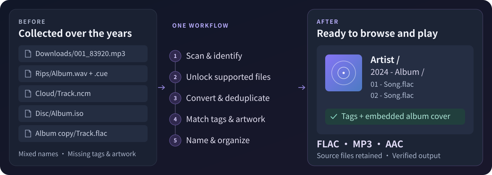
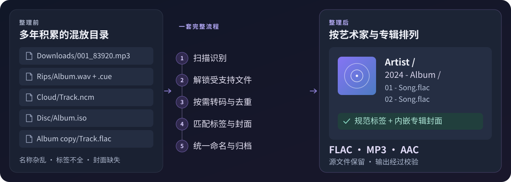

<!-- Edit English between its markers; edit Chinese in README.zh-CN.md.
     Run: python scripts/sync_readme.py -->

<details name="readme-language" open>
<summary><strong>English</strong></summary>

<a name="language-english"></a>

<!-- readme:english:start -->
<div align="center">

# Music Organizer

### Music from everywhere. One organized library.

Organize folders · Convert audio · Unlock supported files · Fix tags · Embed album art

[](https://github.com/jasonfreese36/music-organizer/releases/latest) [](#get-started) [](#license-and-commercial-use)

**English** · [简体中文](#user-content-language-chinese)

**[Download Windows EXE](https://github.com/jasonfreese36/music-organizer/releases/latest/download/MusicOrganizer.exe)** · [Get started](#get-started) · [Report an issue](https://github.com/jasonfreese36/music-organizer/issues)

</div>

Loose MP3s, lossless rips, full-disc images, encrypted downloads, duplicate albums and missing artwork: years of collecting can leave you with files scattered across folders. **Music Organizer brings scanning, unlocking, conversion, metadata, artwork and library organization into one Windows desktop workflow.**



**Portable EXE with its runtime and audio tools included.** No separate Python, FFmpeg or decoder setup. The interface supports English and Simplified Chinese, with light, dark and system appearance.

## From a mixed folder to a finished library

| What you have | What Music Organizer does |
|---|---|
| Downloads and rips scattered across nested folders | Rebuilds an **Artist → Year / Album → Track** library with consistent names. Singles join their releases under `Albums`. |
| MP3, AAC, FLAC, ALAC, APE, WAV and other mixed formats | Produces a **FLAC / MP3 / AAC** playback library, preserving compatible encoded audio and converting where needed. Splits CUE albums by sample positions. |
| Files locked to a music platform | **Locally unlocks supported downloads** from NetEase, QQ Music, Kugou, Kuwo and Migu, then feeds the recovered audio into the same workflow. [Schemes and key requirements ↓](#encrypted-audio-support) |
| Missing or inconsistent tags, platform IDs and untidy names | Cleans platform identifier fields and helps fill or correct **artist, album, title, track number, date and release information** using online matches or your selections. |
| Blank album art or covers left beside the music | Finds local or online artwork and **embeds the selected cover into output tracks**. Tags and covers can come from different search results. |
| Repeated files, alternate masters and LP rips | Skips duplicates confirmed by audio content within the same release, while keeping different recordings, masters and explicitly identified **Vinyl Rip** editions separate. |

Source files stay in place. The organized library is written to a separate destination, with verification and a report of anything that needs attention.

## Fast conversion, less repeated work

- **Parallel processing:** configurable audio tasks and a separate decoding concurrency setting help use your CPU and storage effectively.
- **Less re-encoding:** existing FLAC, MP3 and AAC can retain their audio payload when the selected settings allow it. A CUE image is decoded once before splitting.
- **Cached lookups:** release and artwork queries are grouped by album and cached, reducing repeated requests.
- **Reusable results:** verified outputs and source records let you stop and rerun against the same managed library without rebuilding every completed track.

The release EXE uses **GCC `-O3` + LTO** through Nuitka. Actual throughput depends on the source format, verification settings, disk and online services.

## Get started

1. **Download and open** [MusicOrganizer.exe](https://github.com/jasonfreese36/music-organizer/releases/latest/download/MusicOrganizer.exe). The first launch extracts bundled components.
2. **Choose your folders.** Select a music source and a separate destination, then click **Read-only scan**.
3. **Review the plan.** Inspect tracks, tags and covers. Use **Find tags and artwork** to compare releases or choose a local cover. Advanced settings are optional.
4. **Click Organize.** Review the finished albums and `Needs Review/Review.csv`. Correct uncertain items and rerun to the same destination to update or complete them.

For English, choose **Advanced → Appearance → Interface language → English**, then save and restart. First launch uses the established v1.1 processing defaults; device presets and custom rules are opt-in.

[Detailed user guide (简体中文)](docs/USER_GUIDE.zh-CN.md) · [Build, test and CLI instructions](docs/DEVELOPMENT.md)

### Your library after organizing

```text
Organized/
├── Albums/
│   └── Artist/
│       ├── 2024 - Album/
│       │   ├── 01 - Song.flac       # tags + embedded cover
│       │   └── cover.jpg           # optional extra artwork file
│       └── 2024 - Album [Vinyl Rip]/
├── Disc Archives/                 # DSD/SACD, CUE, encrypted originals
├── Needs Review/                  # missing matches and processing issues
├── Library Records/               # indexes, verification and run reports
└── Playlists/
```

Top-level folders use English names; artist, album and track names keep their original language. Folder structure, filenames and multidisc layout are customizable.

## Release tags and artwork, with a choice of sources

Search multiple providers, compare editions and select **tags and artwork independently**. For example, use MusicBrainz release data with an Apple iTunes cover. You can also supply a local image or an image URL.

| Source | What it contributes |
|---|---|
| **MusicBrainz** | Release, artist, track, label and edition information |
| **Cover Art Archive** | Artwork associated with a specific MusicBrainz release |
| **Apple iTunes** | Digital release and track information, plus album artwork |

Enable sources separately for tags and covers, set priorities and test API/image connectivity from the app. Automatic processing gives existing local tags and covers priority; manual selections let you replace them.

Matching considers artist, release, track title, position and duration. Availability varies by release: uncertain matches and missing covers are reported for review. Selected covers are embedded in the output audio, with an optional `cover.jpg` / `cover.png` alongside it.

## Encrypted audio support

Supported files are identified, decoded locally, verified and organized into the regular library. In regular-library mode, encrypted originals are also archived. **Support is specific to the encryption scheme and version**; some files need a matching local key.

| Platform | Implemented formats / schemes | Key requirements and limits |
|---|---|---|
| **NetEase Cloud Music** | NCM, supported legacy UC cache | NCM uses bundled ncmdump. |
| **QQ Music** | QMC static / Map / RC4, embedded EKey / QTag, TM header restoration | STag, musicex and other external-key variants need the matching local EKey or raw key. |
| **Kugou Music** | Legacy KGM / KGMA / VPR, crypto v3, KGG / crypto v5 | v5 needs its matching EKey; selected `KGMusicV3.db` and `kgg.keys` files can be imported. |
| **Kuwo Music** | Legacy KWM / KWMA | New encryption variants may be incompatible. |
| **Migu Music** | MG3D | Some legacy WAV files recover automatically; other supported files need a fileKey / mask. **MGM is not supported.** |

Use **Advanced → Platform audio** to review support states, import local keys and configure concurrency or full decode verification. Missing keys, damaged files and unsupported versions are reported separately; a failed file does not stop the remaining library. Only explicitly selected key databases are read, using temporary copies. The app does not log into streaming accounts or retrieve keys from a service.

## A library for your player

The default profile organizes a FLAC / MP3 / AAC library and archives DSD/SACD and CUE originals. **v1.4 also includes iPod and iPhone/iPad export presets** under **Advanced → Apple devices**.

| Preset | Newly encoded output | Compatibility limits |
|---|---|---|
| **iPod universal / shuffle** | MP3 256 kbps; 192 kbps in Save space | Mono/stereo, 32 / 44.1 / 48 kHz; ID3v2.3 |
| **iPod classic / nano** | AAC-LC; optional ALAC for lossless sources | Mono/stereo; ALAC up to 16-bit / 44.1 kHz |
| **iPhone / iPad** | AAC-LC; optional ALAC for lossless sources | Mono/stereo; ALAC up to 24-bit / 48 kHz |

Apple exports contain **MP3/M4A audio only**, with embedded JPEG covers. Incompatible formats, sample rates, channels and AAC profiles are converted; compatible MP3/AAC can retain their encoded audio. Extra archive copies are off by default. **Original archives → Save in a separate folder** optionally keeps original audio and disc files outside the import folder. Reports, indexes and playlists stay in a sibling `<destination> - Records` folder. Source files are retained with either archive option.

<details>
<summary>Apple export details</summary>

Select a separate, empty destination. Existing incompatible or non-audio files cause the export to be rejected without deleting them. Device constraints take priority over custom rules. Save space re-encodes lossy sources above 192 kbps; ALAC is generated from lossless sources. Covers are limited to 600 px for iPod and 1000 px for iOS.

The optional archive folder must be independent of the source, output and reports. Originals are copied with byte verification; optional artwork/booklets follow the archive switch. Its local path is excluded from exported reusable profiles.

Import the prepared `Albums` folder into Apple Music/iTunes, then sync with Apple Devices/iTunes. The app prepares files; it does not write an iPod database or sync hardware directly. Generated-audio and packaged-EXE tests have passed; physical-device syncing has not been tested. See Apple's [iPod classic specifications](https://support.apple.com/en-ca/112601), [iPod nano specifications](https://support.apple.com/en-is/112039), [lossless guidance](https://support.apple.com/en-euro/118295), [Windows import instructions](https://support.apple.com/en-mo/guide/music-windows/mus3081/windows) and [sync guide](https://support.apple.com/en-gb/guide/devices-windows/mchlbf6a1fab/1.5/windows/10).

</details>

## Your rules, configured visually

Advanced settings let you tailor the library without writing scripts.

| Setting | Choose what works for you |
|---|---|
| **Folders and filenames** | Artist/album layouts, title-first or track-first names, metadata fields, multidisc folders or prefixes, live path previews |
| **Audio conversion** | Output codec, sample-rate policy, bit depth, channels, SWResample / SoXR, dithering, FLAC compression, MP3 CBR/VBR and AAC bitrate |
| **Conditional rules** | Source codec, bitrate, sample rate, bit depth, channels, size or lossless status; AND/OR conditions; enable, duplicate and reorder |
| **Profiles and previews** | Import/export settings and export a read-only path/conversion plan as CSV; local paths and media keys are excluded from reusable profiles |
| **Appearance** | Light, dark or system mode; five accent colors; English or Simplified Chinese |

For example, point and click to create:

> **If** source codec is AAC **and** bitrate is above 256 kbps → **Convert to MP3**.

The first matching enabled rule wins. Existing MP3/AAC encoding is preserved by default; enable re-encoding when you want new settings applied to the same codec. Lossy-to-lossy conversion introduces another lossy generation, and converting to FLAC cannot restore lost quality.

## Local processing and traceable results

- **Source files are retained:** scan read-only, write to a separate destination, and publish output tracks after conversion, tag and audio checks.
- **Uncertain items stay visible:** CSV/JSON reports record missing matches, covers and processing failures. Same-name files are retained when audio equivalence cannot be confirmed.
- **Music stays on your computer:** online lookup sends release search terms, not audio. Local scanning, conversion and supported decryption can work offline.
- **Local preferences and keys:** preferences, caches and selections live under `%LOCALAPPDATA%/MusicOrganizer`. Imported keys are stored in local JSON without extra encryption; values are excluded from logs, process arguments, reports and exported profiles.

<details>
<summary>Other practical details</summary>

The interactive preview shows up to 6,000 rows with filtering; processing covers all scanned files. Encrypted scans inspect containers, with final success determined during decoding and verification. Vinyl-rip classification requires explicit source/release labels; high sample rate alone is not proof of an LP source. DSD-to-PCM is a conversion: regular-library mode archives DSD/SACD, and Apple profiles offer a separate original archive.

</details>

## Build and contribute

For source users: **Windows 10/11 x64, Python 3.14**. Pinned dependencies, native-tool preparation, `-O3` packaging, tests and CLI examples are in the [developer guide](docs/DEVELOPMENT.md). Releases include the EXE, matching application source, third-party corresponding sources, build information and SHA-256 checksums.

[Report a bug or request a feature](https://github.com/jasonfreese36/music-organizer/issues) · [Contribution guide](CONTRIBUTING.md) · [Corresponding-source instructions](docs/CORRESPONDING_SOURCES.md)

Include the application version, file/encryption version and expected result when reporting an issue. Generated reproductions are welcome; keep personal keys, account databases and copyrighted audio out of public issues.

## License and commercial use

**Original application code: [MIT](LICENSE)** — use, modify, fork and sell it commercially while retaining the MIT notice. Third-party components retain their own licenses. The complete application includes **Mutagen (GPL-2.0-or-later)** and other GPL/LGPL components, so distributing it also requires compliance with their notice and corresponding-source obligations. Commercial distribution remains permitted under those conditions.

See [THIRD_PARTY_NOTICES.md](THIRD_PARTY_NOTICES.md), the retained license texts and [rebuilding instructions](docs/CORRESPONDING_SOURCES.md). Software licensing does not grant rights to music, artwork, streaming accounts or external metadata services.
<!-- readme:english:end -->

</details>

<details name="readme-language">
<summary><strong>简体中文</strong></summary>

<a name="language-chinese"></a>

<div align="center">

# Music Organizer · 音乐整理工具

### 音乐来源再杂，曲库也能井然有序。

有序归档 · 快速转码 · 文件解锁 · 标签规范 · 封面内嵌

[](https://github.com/jasonfreese36/music-organizer/releases/latest) [](#开始使用) [](#开源协议与商业使用)

[English](#user-content-language-english) · **简体中文**

**[下载 Windows EXE](https://github.com/jasonfreese36/music-organizer/releases/latest/download/MusicOrganizer.exe)** · [开始使用](#开始使用) · [反馈问题](https://github.com/jasonfreese36/music-organizer/issues)

</div>

散装 MP3、无损抓轨、整轨 CUE、SACD 原盘、平台加密下载，还有重复的专辑和缺失的封面——多年积累，难免混放。**Music Organizer 把扫描、解锁、转码、标签补全、封面内嵌和目录重排，串成一套完整的 Windows 桌面整理流程。**



**下载便携 EXE 即可使用，运行时与音频工具均已内置。**无需另装 Python、FFmpeg 或解码工具。支持简体中文 / English，以及浅色、深色和跟随系统外观。

## 从混放文件夹，到井然有序的曲库

| 你遇到的混乱 | Music Organizer 如何处理 |
|---|---|
| 下载、抓轨散落各处，目录层级与命名各不相同 | 按 **艺术家 → 年份 / 专辑 → 音轨**重建曲库，统一文件与目录命名；单曲按发行信息归入 `Albums`。 |
| MP3、AAC、FLAC、ALAC、APE、WAV 等格式混放 | 统一为 **FLAC / MP3 / AAC** 播放库，可直接使用的编码音频按设置保留，需要转换的再转码；CUE 整轨按采样位置分轨。 |
| 平台下载的文件无法直接播放 | 在本机**解锁已支持的网易云、QQ 音乐、酷狗、酷我、咪咕加密文件**，还原后自动接入常规整理流程。[支持方案与密钥要求 ↓](#平台加密音频支持范围) |
| 标签缺失、字段不规范，夹杂平台 ID 和杂乱名称 | 清理平台标识字段，通过联网匹配或手动选择，补充、更正**艺术家、专辑、曲名、轨号、日期与发行资料**。 |
| 播放器里封面空白，图片只散落在目录里 | 检索本地及在线图片，把选定的**专辑封面内嵌到输出音轨**；标签与封面可分别选择不同来源。 |
| 同一专辑重复保存，又怕误删 LP rip 或不同母带 | 同一发行内按音频内容确认重复，保留不同录音、母带及明确标识的 **Vinyl Rip** 版本。 |

源文件始终保留在原处。整理结果写入独立目标目录，经过校验，并留下需要关注的项目报告。

## 快速处理，减少重复工作

- **并行处理：**可调音频任务数量，并单独设置解密并发，适应 CPU 与磁盘能力。
- **减少重编码：**设置允许时，已有 FLAC、MP3、AAC 可保留编码音频；CUE 整轨只解码一次再分轨。
- **缓存在线资料：**按专辑查询标签与封面，缓存检索结果，减少重复请求。
- **复用已完成结果：**凭音频校验及来源记录识别已有输出，停止后重跑同一受管理曲库可继续处理。

发布版通过 Nuitka 使用 **GCC `-O3` + LTO** 编译。实际速度取决于源格式、校验设置、磁盘及在线服务。

## 开始使用

1. **下载并打开** [MusicOrganizer.exe](https://github.com/jasonfreese36/music-organizer/releases/latest/download/MusicOrganizer.exe)。首次启动会解压内置组件。
2. **选择目录。**选音乐源文件夹和一个独立目标文件夹，点击“**只读扫描**”。
3. **检查预览。**查看音轨、标签与封面；通过“**查找封面与标签**”比较发行版本，也可指定本地图片。高级设置按需使用。
4. **点击“开始整理”。**查看专辑和 `Needs Review/Review.csv`；修正不确定的项目后，重跑到同一目标库即可更新或补全。

初次打开沿用 v1.1 的默认整理设置，自定义规则与设备预设按需启用。语言可在“**高级设置 → 外观 → 界面语言**”选择，保存并重启后生效。

[完整中文使用手册](docs/USER_GUIDE.zh-CN.md) · [源码构建、测试与命令行](docs/DEVELOPMENT.zh-CN.md)

### 整理后的曲库

```text
Organized/
├── Albums/
│   └── Artist/
│       ├── 2024 - Album/
│       │   ├── 01 - Song.flac       # 规范标签 + 内嵌封面
│       │   └── cover.jpg           # 可选的额外封面文件
│       └── 2024 - Album [Vinyl Rip]/
├── Disc Archives/                 # DSD/SACD、CUE、加密原件
├── Needs Review/                  # 缺失匹配与处理问题
├── Library Records/               # 索引、校验与运行报告
└── Playlists/
```

顶层目录采用英文，艺术家、专辑与曲名保留原语言。目录结构、文件命名、多碟排布均可自定义。

## 标签和封面，来源与版本由你选择

多来源检索、比较发行版本，**标签和封面分别选择**。例如，用 MusicBrainz 的发行资料，搭配 Apple iTunes 的专辑封面。也可以提供本地图片或图片网址。

| 来源 | 提供的资料 |
|---|---|
| **MusicBrainz** | 发行、艺术家、曲目、厂牌及版本信息 |
| **Cover Art Archive** | 对应具体 MusicBrainz 发行版本的专辑图片 |
| **Apple iTunes** | 数字发行、曲目资料与专辑图片 |

可分别启用标签和封面来源、设定优先顺序，并在应用内测试资料接口与图片下载的连通性。自动处理优先使用现有本地标签和封面；手动选择可替换它们。

匹配会核对艺术家、发行、曲名、轨序与时长。在线收录因发行版本而异；匹配不足或封面缺失会列入报告。选定封面内嵌到输出音频，也可额外保存 `cover.jpg` / `cover.png`。

## 平台加密音频支持范围

识别受支持文件后，在本机解密、校验，再并入常规曲库。常规曲库模式同时归档加密原件。**支持范围以加密方案和版本为准**，部分文件需要匹配的本地密钥。

| 平台 | 已实现格式 / 方案 | 密钥要求与限制 |
|---|---|---|
| **网易云音乐** | NCM、受支持的旧 UC 缓存 | NCM 使用内置 ncmdump。 |
| **QQ 音乐** | QMC 静态 / Map / RC4、内嵌 EKey / QTag、TM 头部恢复 | STag、musicex 等外置密钥版本需对应的本地 EKey 或原始密钥。 |
| **酷狗音乐** | 旧 KGM / KGMA / VPR、crypto v3、KGG / crypto v5 | v5 需对应 EKey；可导入指定的 `KGMusicV3.db`、`kgg.keys`。 |
| **酷我音乐** | 旧 KWM / KWMA | 新加密变体可能不兼容。 |
| **咪咕音乐** | MG3D | 部分旧 WAV 可自动恢复，其他受支持文件需 fileKey / 掩码；**暂不支持 MGM**。 |

在“**高级设置 → 平台音频**”中查看支持状态、导入本地密钥、调整并发和完整解码校验。缺密钥、文件损坏、版本未支持会分别报告，单个失败项目不阻断其余处理。仅读取用户明确选择的密钥数据库，在临时副本上操作；程序不登录流媒体账号，也不向平台获取歌曲密钥。

## 为你的播放器准备曲库

默认模式整理为 FLAC / MP3 / AAC 曲库，并归档 DSD/SACD、CUE 等原件。**v1.4 也提供 iPod 与 iPhone/iPad 输出预设**，位于“**高级设置 → 苹果设备**”。

| 设备预设 | 新编码音轨 | 兼容限制 |
|---|---|---|
| **iPod 通用 / shuffle** | MP3 256 kbps；节省空间为 192 kbps | 单声道/立体声，32 / 44.1 / 48 kHz，ID3v2.3 |
| **iPod classic / nano** | AAC-LC；无损来源可选 ALAC | 单声道/立体声；ALAC 最高 16-bit / 44.1 kHz |
| **iPhone / iPad** | AAC-LC；无损来源可选 ALAC | 单声道/立体声；ALAC 最高 24-bit / 48 kHz |

苹果导入目录**只包含 MP3/M4A 音轨，封面内嵌为 JPEG**。不兼容的格式、采样率、声道和 AAC 配置会转换，兼容的 MP3/AAC 可保留编码音频。默认不另存原件，可选“**原盘处理 → 另存到独立文件夹**”，将原始音频与原盘归档在导入目录之外。报告、索引和播放列表放在旁边的 `<目标名> - Records` 文件夹。两种归档选项都保留源文件。

<details>
<summary>展开苹果设备输出细节</summary>

请选择独立的空目标目录。目标已有不兼容文件或非音频文件时会拒绝导出，不删除已有内容。设备限制优先于自定义规则；节省空间会重编码高于 192 kbps 的有损音轨，ALAC 仅从无损来源生成。iPod 封面最大 600 像素，iOS 最大 1000 像素。

独立归档目录须与源、输出及报告目录互不包含。原件复制后进行字节校验，图片附页遵循备份开关；归档路径不写入可复用的导出配置。

将整理后的 `Albums` 导入 Apple Music/iTunes，再通过 Apple Devices/iTunes 同步。程序准备导入文件，不直接写入 iPod 数据库或同步设备。已验证生成样本与编译版 EXE，尚未连接实体设备测试同步。不同代际请核对 Apple 的 [iPod classic 规格](https://support.apple.com/en-ca/112601)、[nano 规格](https://support.apple.com/en-is/112039)、[无损说明](https://support.apple.com/en-euro/118295)、[Windows 导入](https://support.apple.com/en-mo/guide/music-windows/mus3081/windows)及[设备同步说明](https://support.apple.com/en-gb/guide/devices-windows/mchlbf6a1fab/1.5/windows/10)。

</details>

## 你的整理习惯，用界面点选

高级设置中可以调整整理方式，无需编写脚本。

| 设置 | 可以选择什么 |
|---|---|
| **目录与文件名** | 艺术家/专辑结构、歌名或轨号在前、资料字段、多碟目录或前缀、实时路径预览 |
| **音频转换** | 编码、采样率策略、位深、声道、SWResample / SoXR、抖动、FLAC 压缩、MP3 CBR/VBR、AAC 码率 |
| **条件规则** | 来源格式、码率、采样率、位深、声道、大小或是否无损；全部/任一满足；启停、复制与排序 |
| **配置与预览** | 导入/导出设置、导出只读路径与转换计划 CSV；可复用配置不包含本地路径及媒体密钥 |
| **外观与语言** | 浅色、深色、跟随系统；五种主题色；简体中文 / English |

例如，点选建立一条规则：

> **当**来源格式为 AAC，**且**码率高于 256 kbps → **转换为 MP3**。

从上到下采用第一条命中的启用规则。已有 MP3/AAC 默认保留编码；要让同编码音轨应用新参数，需启用重新编码。有损格式互转会再次有损，转为 FLAC 也不会恢复已丢失的音质。

## 本机处理，结果可追溯

- **保留源文件：**只读扫描、独立输出；转换、标签与音频检查完成后再发布目标音轨。
- **问题有据可查：**CSV/JSON 报告记录资料缺失、封面缺失和处理失败。名称相同但无法确认音频一致的文件仍保留。
- **音乐留在本机：**在线检索发送发行查询词，不上传音频；本地扫描、转换及受支持的解密可离线进行。
- **设置与密钥留在本地：**设置、缓存、手选资料位于 `%LOCALAPPDATA%/MusicOrganizer`。导入密钥保存为本地 JSON，未额外加密；密钥值不进入日志、进程参数、报告及导出配置。

<details>
<summary>其他实际使用细节</summary>

交互预览最多显示 6,000 行，可筛选；实际整理处理全部扫描文件。加密文件扫描检查容器信息，最终以解密和校验结果为准。LP rip 分类依靠明确的来源或发行标识，不凭高采样率推定。DSD 转 PCM 属于转换；常规曲库归档 DSD/SACD，苹果预设可选择独立归档原盘。

</details>

## 源码与贡献

源码运行环境为 **Windows 10/11 x64、Python 3.14**。固定依赖、原生工具准备、`-O3` 打包、测试与命令行示例见[开发文档](docs/DEVELOPMENT.zh-CN.md)。发布附件提供 EXE、对应应用源码、第三方对应源码、构建信息与 SHA-256 校验值。

[提交问题或功能建议](https://github.com/jasonfreese36/music-organizer/issues) · [贡献指南](CONTRIBUTING.md) · [第三方对应源码与重建](docs/CORRESPONDING_SOURCES.md)

反馈时请提供应用版本、文件/加密版本和预期结果，欢迎提供可生成的最小复现。个人密钥、账号数据库及受版权保护的音频请勿上传到公开 Issue。

## 开源协议与商业使用

**自有应用源码采用 [MIT](LICENSE)**，允许使用、修改、分叉及商业销售，须保留 MIT 声明。第三方组件保持各自许可；完整应用包含 **Mutagen（GPL-2.0-or-later）**及其他 GPL/LGPL 组件，分发时还须履行其许可声明、对应源码等义务。满足相关条件后仍可商业分发。

详见 [THIRD_PARTY_NOTICES.md](THIRD_PARTY_NOTICES.md)、随附许可文本及[重建说明](docs/CORRESPONDING_SOURCES.md)。软件协议不授予音乐、封面、流媒体账号或外部资料服务的权利。

</details>
